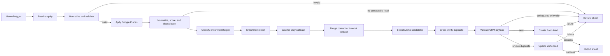

# GTM Lead Sourcing and CRM Enrichment

## Overview

This n8n automation turns a simple territory enquiry into normalized, contactable CRM leads. It sources local businesses through Apify, coordinates role-based enrichment with Clay, checks Zoho CRM for duplicates, and records each accepted or exceptional outcome in Google Sheets.

The project is useful for field-sales and RevOps teams that need a repeatable way to convert location, business type, and keyword criteria into reviewable CRM records without treating every scraped company as qualified.

## Key features

- Manual, spreadsheet-driven sourcing requests.
- Required-field validation before external API use.
- Apify Google Places integration with retries.
- Website, email, phone, company, and location normalization.
- Contactability filtering: email or usable phone is required.
- Deterministic identity keys and in-run deduplication.
- Data-quality scoring and confidence bands.
- Small-company owner targeting and larger-company HR/admin targeting.
- Asynchronous Clay callback with a two-hour timeout fallback.
- Zoho duplicate candidate search and ambiguity routing.
- CRM field-length and email/phone validation.
- Explicit create, update, review, and CRM-failure branches.
- Qualified Output writes only after Zoho confirms success.

## Workflow

1. Read the first enquiry row from Google Sheets.
2. Normalize flexible headers and validate location plus business type.
3. Search Apify for the requested number of businesses.
4. Flatten provider responses, normalize fields, remove duplicates, and discard records with neither email nor usable phone.
5. Score data quality and classify the enrichment target by organization size.
6. Write each record and its n8n resume URL to the Enrichment sheet.
7. Wait for Clay's callback, falling back to company-level data after timeout or a no-person result.
8. Search Zoho CRM for duplicate candidates and classify unique, ambiguous, or new matches.
9. Validate the CRM payload and route to update, create, or Review.
10. Write to Output only after a successful Zoho response; preserve failures in Review.

## Architecture



See [Architecture](docs/architecture.md) for the detailed data flow and failure paths.

## Tech stack

- n8n
- JavaScript Code nodes
- REST APIs and webhooks
- Apify Google Places crawler
- Clay enrichment
- Google Sheets
- Zoho CRM

## Repository structure

```text
.
|-- README.md
|-- CHANGELOG.md
|-- LICENSE
|-- docker-compose.yml
|-- package.json
|-- mcp_config.json
|-- .env.example
|-- .gitignore
|-- scripts/
|   |-- validate-workflow.js
|   `-- simulate-lead-enrichment.js
|-- workflows/
|   `-- gtm-lead-sourcing-and-crm-enrichment.json
|-- docs/
|   |-- architecture.md
|   |-- setup.md
|   `-- troubleshooting.md
`-- examples/
    |-- sample-input.json
    `-- sample-output.json
```

## Quick Start

```bash
# 1. Run offline validation and simulation test
npm run test

# 2. Start local n8n instance via Docker
npm run n8n:up

# 3. Access n8n at http://localhost:5678 and import:
# workflows/gtm-lead-sourcing-and-crm-enrichment.json
```

## Setup instructions

1. Clone this repository.
2. Run `npm run test` to validate the workflow schemas and simulate contactability scoring.
3. Start n8n locally with `npm run n8n:up` or connect to your existing instance.
4. Import `workflows/gtm-lead-sourcing-and-crm-enrichment.json`.
5. Create Google Sheets OAuth2, Apify HTTP Bearer Auth, and Zoho OAuth2 credentials in n8n.
6. Replace `YOUR_GOOGLE_SHEET_ID` and reselect the `Sheet1`, `Enrichment`, `Output`, and `Review` sheets.
7. Configure Clay to enrich queued records and POST results to each row's `clayCallbackUrl`.
8. Add a synthetic enquiry row and run a controlled test against a Zoho sandbox or test lead.
9. Connect AI assistants using the pre-configured Model Context Protocol server (`n8n-mcp`).

Detailed instructions are in [Setup](docs/setup.md).

## Environment variables

The workflow primarily uses n8n credentials and resource locators. `.env.example` is a safe deployment reference; these values are not automatically injected into the imported workflow.

| Variable | Purpose | Required | Safe example |
| --- | --- | --- | --- |
| `GOOGLE_SHEET_ID` | Lead workbook reference | Yes | `YOUR_GOOGLE_SHEET_ID` |
| `APIFY_ACTOR_ID` | Business-directory actor | Yes | `compass/crawler-google-places` |
| `CLAY_TABLE_WEBHOOK_URL` | Optional direct Clay ingestion endpoint | Optional | `YOUR_CLAY_TABLE_WEBHOOK_URL` |
| `N8N_BASE_URL` | Deployment reference | Optional | `https://n8n.example.com` |

## Example input and output

The repository includes synthetic [sample input](examples/sample-input.json) and [sample output](examples/sample-output.json). They demonstrate the data contract without containing customer or personal data.

## Error handling and reliability

- Invalid enquiries and zero-result runs create explicit Review records.
- Apify and Zoho operations retry up to three times with a five-second delay.
- Lead processing is batched one item at a time with throttling after writes.
- Clay callbacks are correlated to the queued `uniqueKey`; timeouts retain company-level fallback data.
- Ambiguous CRM matches are never auto-written.
- Zoho errors use a dedicated failure output and remain recoverable in Review.
- Output records are written only after a successful CRM response.

A dedicated production Error Trigger and notification workflow is planned rather than claimed as present.

## Challenges and decisions

### Contactability before enrichment

Scraped company records without email or a usable phone created review noise. The workflow filters them before Clay and Zoho while preserving a structured zero-result issue when nothing remains.

### Asynchronous enrichment

Clay enrichment is not assumed to finish immediately. n8n stores an execution-specific resume URL and waits for a callback, with a bounded timeout and company-level fallback.

### Duplicate safety

Provider identity is normalized into a deterministic key, while Zoho is searched separately before CRM routing. Multiple CRM candidates are treated as ambiguous and sent to human review.

### Side-effect ordering

The qualified Output sheet is updated only after Zoho confirms the create or update. This avoids reporting a lead as accepted when the CRM write failed.

## Current status

**In development**

> This project is actively being improved. The public repository contains a sanitized version of the workflow with example configuration and data.

The core sourcing, normalization, callback wait, deduplication, CRM routing, and failure branches exist. Clay's outbound callback mapping must be configured separately, and production alerting is not yet included.

## Roadmap

- [ ] Add direct n8n-to-Clay webhook ingestion or document a reusable Clay template.
- [ ] Add a dedicated n8n Error Trigger notification workflow.
- [ ] Replace full Zoho lead scans with indexed, targeted lookup queries where supported.
- [ ] Add reconciliation for executions that time out after an external side effect.
- [ ] Add automated fixture-based tests for Code node transformations.
- [ ] Add configurable concurrency and rate controls before increasing volume.

## Security

- Secrets and credentials are not stored in this repository.
- Credentials must be configured in n8n's credential store.
- Workflow, webhook, sheet, workspace, account, and credential identifiers were removed from the public export.
- Samples are synthetic and use reserved example domains.
- Review least-privilege access, callback handling, and execution-data retention before deployment.

## Author

**Koustav Dey**

Building resilient AI-driven automations, GTM data pipelines, and workflow integrations.

- Email: `koustavdey75@gmail.com`
- GitHub: [imnottaken](https://github.com/imnottaken)
